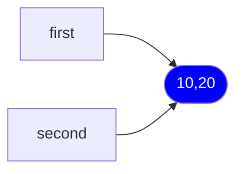
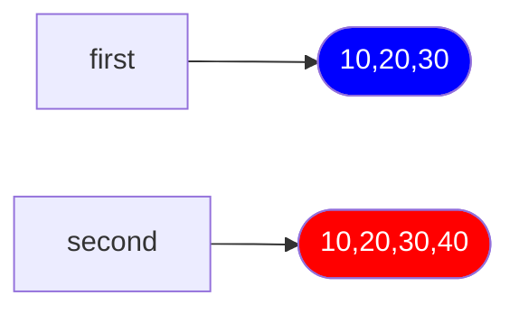

# Задание 1. Имена, ссылки и изменяемость

**Вопросы**
1. Меняет ли присваивание second = first сам объект?
2. Почему операция над неизменяемым объектом приводит к связыванию имени с другим объектом?
3. Как определить, что два имени обозначают один объект?

**Ответы**
1. Нет, присваивание означает, что для объекта со ссылкой `first` добавилась ссылка `second`.
2. Объект неизменяем, это значит, что над ним не возможны никакие операции, которые как либо изменяли его значения. Если попытаться совершить над ним какую либо операцию, которая должна изменить его значение, то выделяется новая ячейка памяти, происходит изменение значения, но сам обяект никуда не пропал, если на него есть другие ссылки.
3. Проверить это можно с помощью оператора `is`

# Задание 2. Поверхностное и глубокое копирование

**Вопросы**
1. Чем поверхностная копия отличается от глубокой?
2. Почему глубокое копирование не следует применять автоматически ко всем объектам?
3. В каких случаях достаточно поверхностной копии?

**Ответы**

1. Поверхностная копия создаёт копию только внешнего объекта, а для внутренних объектов она лишь дублирует ссылки для них, то есть внутренние объекты остаются общими, в то время как внешние - это уже разные объекты.
2. Это долго и требует много памяти, а так же его не следует применять, когда в оригинале содержатся некопируемые объекты, например, открытые файлы.
3. Когда работа с объектом не подразумевает изменение внутренних объектов или внутренние объекты неизменяемы сами по себе.

# Задание 3. Подсчет ссылок и время жизни объекта.

**Вопросы**

1. При каком условии подсчет ссылок позволяет освободить объект?
2. Всегда ли освобождение Python-объекта означает немедленный возврат памяти операционной системе?
3. Чем сильная ссылка отличается от слабой?

**Ответы**
1. Когда счётчик ссылок падает до нуля.
2. Нет, эта память остаётся выделенной для Python`а и может быть переиспользована им, а операционной системе она возвращается только при завершении кода.
3. Сильная ссылка увеличивает счётчик ссылок и держит объект в памяти, а слабая ссылка счётчик не увеличивает и при удалении всех ссильных ссылок возвращает только `None`.

# Задание 4. Циклические ссылки и сборщик мусора

**Вопросы**

1. Как возникает циклическая ссылка?
2. Почему объект с ненулевым счётчиком ссылок иногда может быть недостижим из программы?
3. Зачем сборщик мусора разделяет отслеживаемые объекты по поколениям?

**Ответы**

1. Циклическая ссылка возникает в том случае, когда объект ссылается сам на себя или несколько объектов ссылаются друг на друга, из-за чего образуется замкнутый контур в графе объектов.
2. Потому что могут существовать ссылки на объект в изолированном подграфе, как было продемонстрировано в задании.
3. Это оптимизирует его работу. В 0 поколение попадают новые объекты, в 1 переходят объекты, 'пережившие' проверку в 0 поколении, переход во 2 поколение аналогичен предыдущему. Благодаря этой системе, объекты, которые пережили много сборок мусора, проверяются редко, а новые проверяются часто.

# Задание 5. Исследование потребления памяти.

**Вопросы**

1. Увеличивается ли размер списка после каждого `append()`?
2. Почему список резервирует место с запасом?
3. Чем длина списка отличается от объёма выделенной памяти?

**Ответы**

1. Нет, размер списка увеличивается тогда, когда заканчивается выделенное под него место.
2. Это помогает в оптимизации, потому что проще выделить больше памяти сразу, чем каждый раз добавлять немного памяти.
3. Длина списка показывает количество реально хранящихся элементов, а объём выделенной памяти — сколько слотов зарезервировано под элементы, включая пустые.

# Способы уменьшения потребления памяти
1. Использование слабых ссылок для кэшей и реестров. Использование weakref.WeakValueDictionary и реестра объектов Record. Обычный словарь удерживает все свои значения сильными ссылками. Если использовать его как кэш или реестр, объекты будут жить в памяти до тех пор, пока жив сам словарь, даже если они больше нигде не используются. Это приводит к утечкам памяти и невозможности автоматической очистки.
2. Использование ленивых последовательностей вместо материализованных. Сравнение list(range(100_000)) и range(100_000) через tracemalloc. Материализованные последовательности хранят все элементы в памяти одновременно. Для больших объёмов данных это требует огромных затрат памяти
3. Предварительное выделение размера контейнеров. Исследование роста списка через sys.getsizeof() при добавлении 100 элементов. Списки используют геометрическую стратегию роста. Это приводит к многократным перевыделениям памяти и удвоению потребляемой памяти в моменте. 
4. 
| Способ копирования | Время выполнения | Затраты памяти | Преимущества | Недостатки |
|---|---|---|---|---|
| Присваивание (`=`) | O(1) | O(1) дополнительной памяти | Быстро, не создаёт новый объект | Изменения объекта доступны через обе переменные |
| Поверхностная копия (`copy()`) | O(n) | O(n) | Создаёт новый внешний объект | Вложенные изменяемые объекты остаются общими |
| Глубокая копия (`deepcopy()`) | O(n) в простом случае | O(n) | Копирует также вложенные объекты | Требует больше времени и памяти |

# Наиболее опасные ошибки при работе с изменяемыми объектами.
1. Неявное разделение ссылок
2. Поверхностное копирование
3. Циклические ссылки
4. Материализация больших последовательностей
5. Сильные ссылки в кэшах
6. Игнорирование роста списков